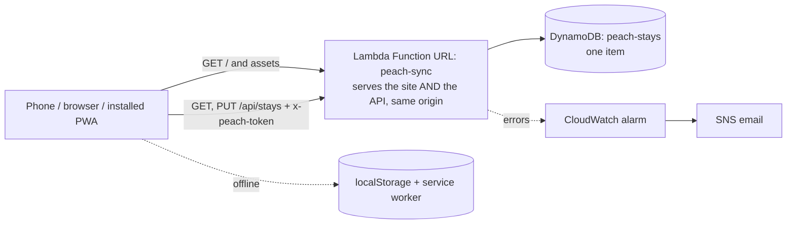

# peach 🍑

An installable web app that tracks one person's Schengen stays and computes the rolling 90/180-day count: days used and left today, the latest date she must leave, and a planner ("if I enter on X, how long can I stay?"). Built for a real user (my wife), not as a demo. Planning aid only: always confirm with the [official European Commission calculator](https://home-affairs.ec.europa.eu/policies/schengen/border-crossing_en).

## Architecture



- **Frontend:** Vite + vanilla JS. The calculation engine (`src/lib/schengen.js`) is pure functions taking the date as a parameter, unit-tested with Vitest. EN + KA UI, light/dark.
- **Hosting:** the built site is bundled into the same Lambda that serves the API. One URL, same origin, no CORS, no separate static host.
- **Storage:** one DynamoDB item (provisioned 1/1). Stays are `{id, entry, exit, note, updatedAt, deleted}`; the item carries an integer `version` for optimistic concurrency.
- **Offline-first:** reads/writes go to localStorage first and sync after; a service worker caches the shell. JSON export/import is the escape hatch.
- **Sync:** `PUT` is conditional on `version`. On `409` the client merges (union by `id`, newer `updatedAt` wins, tombstones for deletes) and retries.

## Why the site is served by the Lambda

The app has exactly one user, so the site and the API live behind one Function URL: same origin (no CORS block, no preflight failure mode), one deploy, one place to look when something breaks, still $0. The code is public; the deployed URL and the secret token are not. Anyone who finds the URL gets an empty app shell: there is no travel data in the repo or the bundle, and `/api/stays` answers 401 without the token.

## Security decisions

| Decision | Why |
|---|---|
| No analytics, no cookies, no accounts; no personal data or secrets in the repo | Travel history is personal data; the repo is public, so nothing sensitive may ever be committed |
| One secret token; only its SHA-256 reaches AWS (Lambda env var) | A read of Terraform state or the Lambda config leaks nothing usable |
| Token carried in the URL fragment (`#k=…`), stored locally, then stripped from the address bar | Fragments are never sent to servers or logged |
| Constant-time hash comparison; empty hash configured = nobody gets in | No timing signal, fails closed |
| 401 returned before any DynamoDB call | Scanners hitting the URL cost nothing and touch no data |
| Server rebuilds every stay from known fields; 64 KB body, 500 stays, ISO-date and length checks | Nothing unexpected is ever stored |
| CSP (`default-src 'self'`, no inline script, `frame-ancestors 'none'`), `noindex`, `robots.txt` Disallow | Smaller attack surface; not indexed |
| Lambda outside any VPC; IAM limited to `GetItem`/`PutItem` on one table | No NAT cost, least privilege |
| CI role: OIDC only, trust limited to `main` and PRs of this repo, writes scoped to `peach-*` ARNs | Zero static credentials |
| IAM Deny policy (console-attached) + CI guard blocking EC2/NAT/ALB/RDS/etc. | Can't accidentally create billed resources |

## Cost: $0/month

| Piece | Cost |
|---|---|
| Lambda + Function URL | Always Free |
| DynamoDB provisioned 1/1 | Always Free (account pool use 9/9 of 25/25) |
| CloudWatch alarm, SNS email, logs (14-day retention) | Always Free |
| Terraform state object (shared bucket) | a fraction of a cent |

## Deploy (first time)

```bash
./scripts/gen-token.sh                      # prints her TOKEN (password manager) + the hash export
export TF_VAR_token_sha256=<hash>  TF_VAR_alert_email=<you@example.com>
export AWS_PROFILE=terraform-deploy  AWS_PAGER=""   # the IAM user with the Deny policy, never root

npm ci && npm test -- --run && npm run package
cd infra && terraform init && terraform fmt -recursive && terraform validate && terraform plan
# plan must contain only: DynamoDB, Lambda, URL, IAM roles/policies, log group, SNS, alarm
terraform apply
URL=$(terraform output -raw function_url)

# smoke tests
curl -s -o /dev/null -w "%{http_code}\n" "$URL"                                   # 200 (app shell)
curl -s -o /dev/null -w "%{http_code}\n" "${URL}api/stays"                        # 401
curl -s -w "\n%{http_code}\n" -H "x-peach-token: $TOKEN" "${URL}api/stays"        # 404 (empty)
```

Then: confirm the SNS subscription email; in GitHub set secrets `PEACH_TOKEN_SHA256`, `PEACH_ALERT_EMAIL` (also in the **Dependabot** secrets store) and variable `AWS_ROLE_ARN` = `terraform output -raw ci_role_arn`. From then on, merging to `main` tests, builds, packages and applies.

**Her link** = `${URL}#k=${TOKEN}`. Send it privately (Signal/WhatsApp). Rotating the token = run `gen-token.sh`, apply the new hash, send the new link.

## Installing on her phone

- **Android (Chrome):** open the link, then menu → *Install app*.
- **iPhone (Safari):** open the link, Share → *Add to Home Screen*. An installed iOS app has its own storage, so open it once and paste the link in **Settings → Link this device**.
- **Moving to a new phone:** open the link there (or paste it in Settings). Her stays sync down.

## Lessons learned

- For a single-user app whose backend is already a Lambda, serving the site from it removes CORS and a second deploy target.
- Serving the site and API from one origin deletes the CORS block and the preflight failure mode entirely.
- Optimistic concurrency (`version` + conditional write) plus tombstoned merge makes "two devices, one offline" safe without accounts.
- Keep the clock out of the engine: every function takes the date as a parameter, which is what makes the window-boundary and leap-year tests possible.

## Repo hygiene (public repo)

Never commit: the token, `*.tfvars`, `*.tfstate`, `infra/peach-sync.zip`, `build/`. The token hash lives only in GitHub secrets and the Lambda environment. Settings → Actions → General → *Require approval for all outside collaborators*, so workflow runs from strangers' PRs never start.

MIT licensed.
